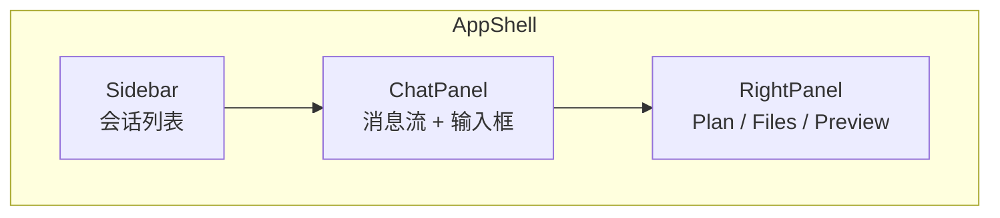
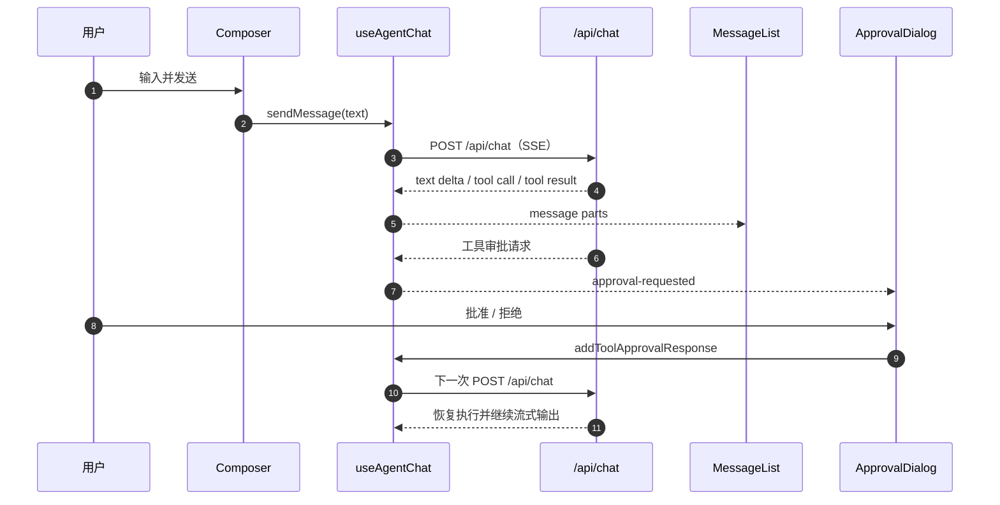

# 前端架构

## 1. 运行环境

| 项 | 值 |
| --- | --- |
| 框架 | React 19 |
| 语言 | TypeScript |
| 构建工具 | Vite |
| 样式 | Tailwind CSS |
| 组件库 | 本地最小 UI 组件（shadcn 风格） |
| 图标 | lucide-react |
| 聊天流 | `ai` v6 + `@ai-sdk/react` 3 的 `useChat` |
| Markdown | react-markdown + remark-gfm |
| 代码高亮 | shiki |
| 文本差异 | diff |
| Node.js | 24 |

前端工程位于 `frontend/`，独立于后端工程。

## 2. 目录结构

```text
frontend/
├── package.json
├── vite.config.ts
├── tsconfig.json
├── index.html
└── src/
    ├── main.tsx
    ├── App.tsx
    ├── api/
    │   ├── client.ts
    │   └── types.ts
    ├── hooks/
    │   ├── useAgentChat.ts
    │   └── useConversations.ts
    ├── components/
    │   ├── auth/
    │   │   └── LoginPage.tsx
    │   ├── layout/
    │   │   ├── AppShell.tsx
    │   │   └── Sidebar.tsx
    │   ├── chat/
    │   │   ├── ChatPanel.tsx
    │   │   ├── MessageList.tsx
    │   │   ├── MessageItem.tsx
    │   │   └── Composer.tsx
    │   ├── tools/
    │   │   ├── ToolCallCard.tsx
    │   │   ├── ShellOutput.tsx
    │   │   ├── FileDiff.tsx
    │   │   └── ApprovalDialog.tsx
    │   ├── plan/
    │   │   └── PlanPanel.tsx
    │   ├── workspace/
    │   │   ├── FileTree.tsx
    │   │   ├── FileViewer.tsx
    │   │   └── PreviewPane.tsx
    │   └── ui/
    │       └── button.tsx
    ├── lib/
    │   ├── markdown.tsx
    │   ├── shiki.ts
    │   ├── tool-meta.ts
    │   └── utils.ts
    └── styles/
        └── globals.css
```

## 3. 页面结构



| 区域 | 内容 |
| --- | --- |
| Sidebar | 新会话、会话列表、删除会话、当前用户 |
| ChatPanel | 消息列表、工具调用卡片、审批对话框、输入框、停止按钮 |
| RightPanel | `Plan`、`Files`、`Preview` 三个标签页 |

## 4. 数据流



`useAgentChat` 的入参：

| 参数 | 说明 |
| --- | --- |
| `conversationId` | 当前 conversation_id，作为 `useChat` 的 `id` |
| `initialMessages` | 服务端返回的初始消息 |
| `onFinish` | 流结束后的回调，用于刷新会话详情 |
| `onUnauthorized` / `onNotFound` / `onBusy` | 401 / 404 / 409 处理 |

`useChat` 提供 `messages`、`status`、`stop()`、`addToolApprovalResponse()` 等返回值。

## 5. 组件职责

| 组件 | 职责 |
| --- | --- |
| `AppShell` | 整体布局，持有 `activeConversationId` |
| `Sidebar` | 会话列表、新建会话、删除会话 |
| `ChatPanel` | 加载会话详情，组合消息列表、输入框与右侧面板 |
| `MessageList` | 按顺序渲染 `message.parts`，管理滚动位置 |
| `MessageItem` | 根据 part 类型分发到文本、工具、审批等渲染器 |
| `Composer` | 文本输入、发送、停止 |
| `ToolCallCard` | 工具名、参数摘要、状态、结果区域 |
| `ShellOutput` | 展示命令原始输出，并识别退出码 |
| `FileDiff` | 以逐行 +/- 列表展示 `write_file` / `edit_file` 的前后差异 |
| `ApprovalDialog` | 展示待审批工具、参数、原因；提交批准或拒绝 |
| `PlanPanel` | 解析 `Planning` 工具结果并渲染任务清单 |
| `FileTree` | 请求并展示沙箱目录 |
| `FileViewer` | 展示沙箱文件内容 |
| `PreviewPane` | 以 iframe 展示沙箱端口预览 |

## 6. 消息渲染

| part 类型 | 渲染组件 |
| --- | --- |
| `text` | `Markdown` |
| `reasoning` | 折叠的推理块 |
| `tool-shell` / `tool-run_command` / `tool-start_command` | `ToolCallCard` + `ShellOutput` |
| `tool-read_file` | `ToolCallCard` + 代码块 |
| `tool-write_file` / `tool-edit_file` | `ToolCallCard` + `FileDiff` |
| `tool-list_files` / `tool-grep` | `ToolCallCard` + 结果列表 |
| `tool-delegate_task` | `ToolCallCard` + 子任务结果 |
| `tool-write_plan` / `tool-update_task_status` / `tool-read_plan` | `ToolCallCard`，并同步 `PlanPanel` |
| 其他 `tool-*` | `ToolCallCard` 的通用渲染 |

消息区顶部的 token 用量来自 `GET /api/conversations/{id}` 返回的 `last_run.usage` 字段。

工具名与展示信息的映射集中在 `lib/tool-meta.ts`：

| 工具名 | 标题 | 图标 |
| --- | --- | --- |
| `shell` | Shell | `Terminal` |
| `run_command` | Run command | `Terminal` |
| `read_file` | Read file | `FileText` |
| `write_file` | Write file | `FilePlus` |
| `edit_file` | Edit file | `FilePen` |
| `list_files` | List files | `FolderTree` |
| `grep` | Search | `Search` |
| `delegate_task` | Delegate task | `Bot` |
| `write_plan` | Update plan | `ListTodo` |
| `update_task_status` / `update_task_statuses` | Update plan | `ListTodo` |

## 7. 状态管理

| 状态 | 持有者 |
| --- | --- |
| 消息、流式状态、错误 | `useChat` |
| 当前 conversation_id | `AppShell` |
| 会话列表 | `useConversations` |
| 右侧面板标签 | `ChatSession` 的本地 state |
| 审批对话框开关 | `ChatPanel` 扫描消息中的 `approval-requested` part，渲染 `ApprovalDialog` |

不引入全局状态库。跨组件数据通过 props 和自定义 hook 传递。

## 8. 文本与代码渲染

- 普通文本使用 `react-markdown` 渲染，启用 `remark-gfm`。
- 代码块通过 `shiki` 高亮，主题为 `github-dark`。
- 行内代码使用等宽字体，不进行高亮。
- `ShellOutput` 保留原始换行与空白，使用等宽字体，并识别 `[exit code: N]`。
- `FileDiff` 使用 `diff` 逐行比较，新增行与删除行使用不同背景色。
- 长消息不做虚拟滚动；`MessageList` 在用户位于底部时自动滚动，用户上滚后停止自动滚动。

## 9. API 交互

| 方法 | 路径 | 用途 |
| --- | --- | --- |
| `POST` | `/api/auth/login` | 登录 |
| `POST` | `/api/auth/register` | 注册 |
| `POST` | `/api/auth/demo` | 演示账号登录 |
| `POST` | `/api/auth/logout` | 退出登录 |
| `GET` | `/api/me` | 当前用户 |
| `POST` | `/api/chat` | 发送消息，返回 SSE |
| `GET` | `/api/conversations` | 会话列表 |
| `POST` | `/api/conversations` | 新建会话 |
| `GET` | `/api/conversations/{id}` | 会话详情与消息 |
| `DELETE` | `/api/conversations/{id}` | 删除会话 |
| `POST` | `/api/conversations/{id}/cancel` | 取消当前 run |
| `GET` | `/api/runs/{id}` | run 状态与用量 |
| `GET` | `/api/conversations/{id}/sandbox/files?path=` | 沙箱目录 |
| `GET` | `/api/conversations/{id}/sandbox/file?path=` | 沙箱文件内容 |
| `GET` | `/api/conversations/{id}/sandbox/preview/{port}` | 沙箱端口预览地址 |
| `POST` | `/api/conversations/{id}/files` | 上传文件到沙箱 |

错误处理：

| 状态码 | 前端行为 |
| --- | --- |
| `401` | 跳转登录页 |
| `404` | 关闭当前会话，回到空状态 |
| `409` | 显示错误条与重试按钮，禁用输入框 |
| `5xx` | 显示错误条，保留已接收的消息 |

SSE 流中的错误通过 `useChat` 的 `onError` 回调进入 `chat.error`，`ChatPanel` 渲染为错误条，`Composer` 恢复可发送状态。

## 10. 构建与运行

```bash
cd frontend
npm install
npm run dev
```

开发服务器将 `/api` 代理到后端：

```ts
server: {
  proxy: {
    '/api': 'http://127.0.0.1:8000',
  },
}
```

生产构建：

```bash
npm run build
```

构建产物为 `frontend/dist/`，由 Caddy 作为静态文件托管。
